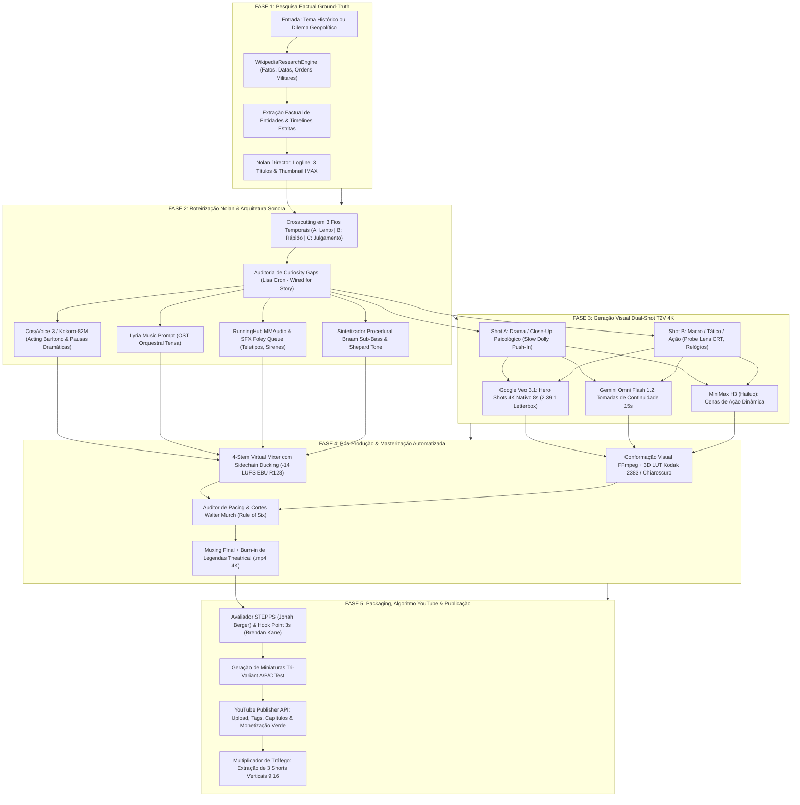
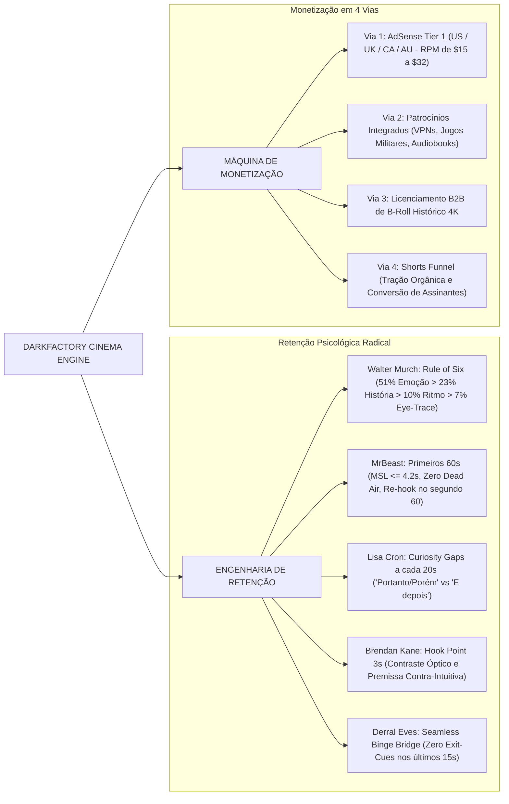
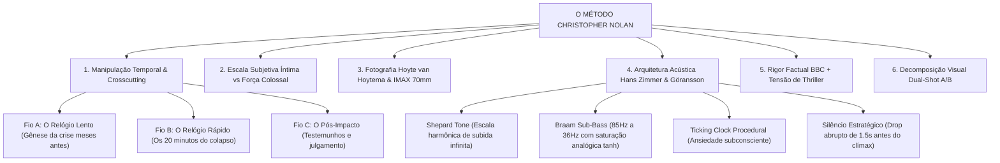
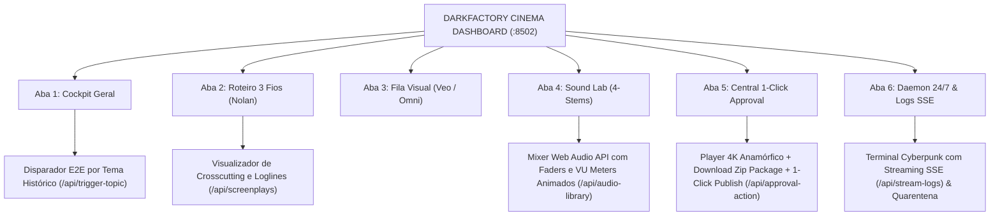

# DarkFactory — Autonomous YouTube Cinema Engine

<p align="center">
  
</p>

> **Fábrica Autônoma Industrial de Cinema Documental, Engenharia Reversa Histórica e Monetização de Alta Retenção para Canais Dark no YouTube. Arquitetura Não-Linear Christopher Nolan, Geração Visual Dual-Shot T2V 4K IMAX (Google Veo 3.1, Gemini Omni Flash 1.2 & MiniMax H3), Roteamento Vocal Dinâmico (`bm_george` BBC / Kokoro-82M / CosyVoice 3), Sound Design Procedural de 4 Stems (-14 LUFS EBU R128), Auditoria Algorítmica EDSA & STEPPS (27 Livros Canônicos) e Dashboard Web SPA iOS 27 Liquid Glass (:8502).**

[](https://www.python.org/)
[](https://fastapi.tiangolo.com/)
[](https://docs.pytest.org/)
[](https://ai.google.dev/)
[](https://minimaxi.com/)
[](https://github.com/thewh1teagle/kokoro-onnx)
[](https://ffmpeg.org/)
[](https://www.kodak.com/)
[](https://developer.apple.com/design/)
[](LICENSE)

---

##  Sumário Executivo

1. [Visão Geral do Sistema & Propósito Industrial](#-visão-geral-do-sistema--propósito-industrial)
2. [Arquitetura de Alto Nível & Topologia da Esteira](#-arquitetura-de-alto-nível--topologia-da-esteira)
3. [Mapa Mental da Máquina de Retenção & Monetização](#-mapa-mental-da-máquina-de-retenção--monetização)
4. [O Método Christopher Nolan (Os 6 Pilares Cinematográficos)](#-o-método-christopher-nolan-os-6-pilares-cinematográficos)
5. [DarkFactory Master Knowledge Vault (Os 27 Livros Canônicos)](#-darkfactory-master-knowledge-vault-os-27-livros-canônicos)
6. [Detalhamento Técnico das 5 Fases da Fábrica](#-detalhamento-técnico-das-5-fases-da-fábrica)
   - [Fase 1: Concepção Factual & Research Ground-Truth Engine](#fase-1-concepção-factual--research-ground-truth-engine)
   - [Fase 2: Roteirização Nolaniana, Roteamento Vocal Dinâmico & Sound Design 4-Stems](#fase-2-roteirização-nolaniana-roteamento-vocal-dinâmico--sound-design-4-stems)
   - [Fase 3: Geração Visual Dual-Engine (Google Flow Veo 3.1, Gemini Omni 1.2 & RunningHub)](#fase-3-geração-visual-dual-engine-google-flow-veo-31-gemini-omni-12--runninghub)
   - [Fase 4: Pós-Produção, Color Grading Kodak & Masterização EBU R128](#fase-4-pós-produção-color-grading-kodak--masterização-ebu-r128)
   - [Fase 5: Packaging de Retenção, Algoritmo YouTube & Publicação](#fase-5-packaging-de-retenção-algoritmo-youtube--publicação)
7. [Dashboard Web SPA Nativo (iOS 27 Liquid Glass Cinema Edition :8502)](#-dashboard-web-spa-nativo-ios-27-liquid-glass-cinema-edition-8502)
8. [Multiplicador de Tráfego: Gerador de Shorts Verticais 9:16](#-multiplicador-de-tráfego-gerador-de-shorts-verticais-916)
9. [Daemon Autônomo 24/7 & Watchdog de Produção](#-daemon-autônomo-247--watchdog-de-produção)
10. [Contratos de Dados (Data Schemas Tipados)](#-contratos-de-dados-data-schemas-tipados)
11. [Instalação, Configuração & Execução CLI](#-instalação-configuração--execução-cli)
12. [Resiliência Operacional & Decisões Arquiteturais (ADRs)](#-resiliência-operacional--decisões-arquiteturais-adrs)

---

##  Visão Geral do Sistema & Propósito Industrial

O **DarkFactory** é uma plataforma autônoma de engenharia de mídia de ponta a ponta projetada para transformar eventos históricos reais, documentos desclassificados de inteligência (KGB, CIA, MI6) e momentos de tensão geopolítica extrema em **thrillers cinematográficos de padrão Netflix / BBC** para canais dark no YouTube.

Diferente de canais automatizados convencionais baseados em "AI slop" (slideshows monótonos de imagens estáticas, narrações robóticas e cronologias escolares), o DarkFactory opera sob **rigor estético de cinema autoral**:

- **Arquitetura Narrativa Não-Linear**: Inspirada em *Dunkirk* e *Oppenheimer*, decompondo cada documentário em 3 fios temporais sincronizados (*Crosscutting*).
- **Direção Óptica Hoyte van Hoytema**: Aspect ratio anamórfico 2.39:1, simulação física de película Kodak Vision3 500T 5219, lentes Cooke Anamorphic 35mm f/2.0 e iluminação *Chiaroscuro* de baixa chave.
- **Sound Design Hans Zimmer & Ludwig Göransson**: Arquitetura procedural de 4 stems isolados com sintetizador de *Shepard Tone* contínuo, impactos *Braam Sub-Bass* e *Dynamic Sidechain Ducking* a **-14 LUFS (EBU R128)**.
- **Auditoria de Retenção Baseada nos Mestres**: Algoritmos matemáticos derivados dos 27 livros canônicos de cinema e atenção (Walter Murch, MrBeast, Lisa Cron, Jonah Berger, Derral Eves).
- **Publicação Automatizada com 100% Green Dollar**: Tri-Variant Thumbnails A/B/C, metadados em conformidade com EDSA (*Educational/Documentary Context*) e API oficial do YouTube Studio.

---

##  Arquitetura de Alto Nível & Topologia da Esteira



---

##  Mapa Mental da Máquina de Retenção & Monetização

A operação do DarkFactory foi arquitetada para maximizar a **Taxa de Retenção Média (AVD > 55%)**, o **CTR de Embalagem (CTR > 10%)** e a geração de receita em **4 vias independentes de fluxo de caixa**:



---

##  O Método Christopher Nolan (Os 6 Pilares Cinematográficos)

Todo episódio gerado pelo DarkFactory é estruturado seguindo as diretrizes autorais de Christopher Nolan:



---

##  DarkFactory Master Knowledge Vault (Os 27 Livros Canônicos)

O DarkFactory incorpora princípios destilados das **27 obras de referência mundiais** (Walter Murch, MrBeast, Lisa Cron, Jonah Berger, Brendan Kane, Derral Eves, Alex Hormozi) diretamente nos motores de roteiro, embalagem algorítmica e auditoria EDSA em [`src/nolan_director.py`](src/nolan_director.py), [`src/youtube_algorithm_booster.py`](src/youtube_algorithm_booster.py) e [`src/youtube_compliance_qc.py`](src/youtube_compliance_qc.py):

| Autor & Obra | Conceito Canônico Incorporado | Aplicação no DarkFactory |
| :--- | :--- | :--- |
| **Walter Murch**<br>*In the Blink of an Eye*<br>*Suddenly Something Clicked* | **The Rule of Six & The Blink Theory**<br>Emoção (51%) > História (23%) > Ritmo (10%) > Eye-Trace (7%) > Plano 2D (5%) > Espaço 3D (4%). Cortes sincronizados com pontuações cognitivas naturais. | Decupagem de cenas em [`src/nolan_director.py`](src/nolan_director.py) e transições micro *dip-to-black* (0.15s) em [`src/render_pilot_video.py`](src/render_pilot_video.py). |
| **MrBeast**<br>*How To Succeed At MrBeast Production* | **A Lei dos Primeiros 60 Segundos**<br>Hooks de alta densidade visual, eliminação de tempo morto e *Re-hook* no primeiro minuto para sustentar AVD acima de 55%. | Estrutura de abertura imediata do manifesto Nolan + cortes dinâmicos por cena e *Seamless Binge Bridge* no encerramento. |
| **Lisa Cron**<br>*Wired for Story* | **Neurociência Narrativa & Curiosity Gaps**<br>O cérebro evoluiu histórias como simulações de sobrevivência. Abertura contínua de lacunas de informação entre linhas temporais. | Estruturação dos 3 fios paralelos em [`src/nolan_director.py`](src/nolan_director.py) e detecção de *exit-cues* em [`src/youtube_algorithm_booster.py`](src/youtube_algorithm_booster.py). |
| **Jonah Berger**<br>*Contagious* | **Framework STEPPS & Alta Excitabilidade**<br>Moeda Social (documentos desclassificados), Gatilhos e emoção fisiológica de alta ativação. | Pacote mestre algorítmico e cálculo STEPPS em [`src/youtube_algorithm_booster.py`](src/youtube_algorithm_booster.py) e no manifesto do episódio. |
| **Brendan Kane**<br>*The Guide to Going Viral*<br>*Hook Point* | **Regra do Hook Point de 3 Segundos**<br>Quebra óptica de padrão nos primeiros 3 segundos, alto contraste visual e premissa contra-intuitiva sem preâmbulos. | Shot A de abertura psicológica + primeira frase de impacto vocal e geração de miniaturas A/B/C de alto contraste. |
| **Derral Eves**<br>*The YouTube Formula* | **Multiplicador Algorítmico: CTR x AVD x Sessão**<br>Série oficial serializada para dominar vídeos sugeridos e *Seamless Binge Bridge* sem despedidas prematuras. | Métodos `validate_and_enforce_seamless_outro()` e `generate_official_series_playlist_metadata()` em [`src/youtube_algorithm_booster.py`](src/youtube_algorithm_booster.py). |
| **Alex Hormozi**<br>*100M Leads* | **Equação de Valor Percebido & Ganchos Magnéticos**<br>Títulos magnéticos de alta curiosidade, contraste extremo e promessa histórica concreta sem jargões herméticos. | Otimizador de 3 opções de título e overlays de miniatura por episódio em `NolanHistoryDirector`. |

---

##  Detalhamento Técnico das 5 Fases da Fábrica

### Fase 1: Concepção Factual & Research Ground-Truth Engine
- **Módulos Centrais**: [`src/research_engine.py`](src/research_engine.py), [`src/nolan_director.py`](src/nolan_director.py)
- **Entradas**: Tema histórico sugerido, arquivo militar ou evento geopolítico.
- **Saídas**: Dossiê factual da Wikipedia (`WikipediaResearcher`) com figuras históricas, localidades e ganchos dramáticos, logline, 3 opções de títulos de alto CTR e conceito de miniatura IMAX.
- **Comando CLI**:
  ```bash
  python -m src.research_engine --topic "1983 Soviet nuclear false alarm incident"
  ```

### Fase 2: Roteirização Nolaniana, Roteamento Vocal Dinâmico & Sound Design 4-Stems
- **Módulos Centrais**: [`src/nolan_director.py`](src/nolan_director.py), [`src/generate_pilot_audio.py`](src/generate_pilot_audio.py), [`src/kokoro_fallback.py`](src/kokoro_fallback.py), [`src/cosyvoice_master.py`](src/cosyvoice_master.py), [`src/generate_sound_design.py`](src/generate_sound_design.py)
- **Roteamento Vocal Dinâmico (`bm_george` Padrão Ouro)**:
  - **Narrador Padrão (`bm_george`)**: Voz britânica solene estilo BBC / Christopher Nolan (`DEFAULT_VOICE = "bm_george"`, velocidade `0.98`) com mapeamento dinâmico via `--voice` (`bm_george`, `bm_lewis` para urgência dramática, `am_adam` americano) em Kokoro-82M ONNX local e fallback automático via Edge-TTS (`en-US-ChristopherNeural` / `en-US-EricNeural`).
  - **Masterização Broadcast**: Cadeia EQ & compressão curva Ableton Live Complex Pro a **-14 LUFS** (WAV 24-bit/48kHz + MP3 320kbps) com legendas `.srt` sincronizadas por cena (`data/subtitles/pilot_bm_george_full.srt`).
  - **Guias de Execução RunningHub**: Guias manuais/RPA prontos em [`RUNNINGHUB_INSTRUCT_GUIDE.md`](RUNNINGHUB_INSTRUCT_GUIDE.md) para CosyVoice 3 Instruct 2 (Workflow `2118531898170486785`) e filas MMAudio/Whoosh.
- **Comandos CLI**:
  ```bash
  python -m src.nolan_director --topic "1983 Soviet nuclear false alarm incident"
  python -m src.generate_pilot_audio --voice bm_george --speed 0.98
  python -m src.kokoro_fallback --script data/scripts/pilot_soviet_glitch.json --voice bm_george
  ```

### Fase 3: Geração Visual Dual-Engine (Google Flow Veo 3.1, Gemini Omni 1.2 & RunningHub)
- **Módulos Centrais**: [`src/google_flow_bot.py`](src/google_flow_bot.py), [`src/nolan_director.py`](src/nolan_director.py), [`RUNNINGHUB_VIDEO_PROMPTS.md`](RUNNINGHUB_VIDEO_PROMPTS.md)
- **Arquitetura Dual-Shot A/B**:
  - **Shot A (Drama / Close-Up Psicológico)**: Câmera em *slow push-in dolly*, close nos olhos e micro-expressões sob Chiaroscuro (`google_flow_omni_queue.json`).
  - **Shot B (Macro / Tático / Ação)**: Lente probe macro em ponteiros, telas CRT de radar com fósforo verde, fumaça cortando o feixe de luz (`google_flow_veo3_queue.json`).
- **Motores Alvo**:
  - **Google Veo 3.1**: Hero Shots em 4K, 8 segundos por tomada, proporção anamórfica 2.39:1.
  - **Gemini Omni Flash 1.2**: Tomadas de continuidade temporal de até 15 segundos com imagens de referência.
  - **RunningHub Fallback (`2115926169974812674`)**: Prompts calibrados para geração I2V/T2V no RunningHub sob execução **Lite/Plus**.

### Fase 4: Pós-Produção, Color Grading Kodak & Masterização EBU R128
- **Módulos Centrais**: [`src/audio_mixer_master.py`](src/audio_mixer_master.py), [`src/generate_cinematic_lut.py`](src/generate_cinematic_lut.py), [`src/render_pilot_video.py`](src/render_pilot_video.py)
- **Processamento de Áudio 4-Stems**:
  ```mermaid
  flowchart LR
      V["Stem 1: Voz (CosyVoice / Kokoro bm_george)"] --> SC["Dynamic Sidechain Detector"]
      M["Stem 2: Trilha Lyria (OST Tensa)"] --> DK["Sidechain Ducking (-18dB quando há fala)"]
      F["Stem 3: Foley & SFX (Sirenes, Teletipos)"] --> SUM["Master Bus Summation"]
      B["Stem 4: Sub-Bass Braam & Shepard Tone"] --> SUM
      SC --> DK
      DK --> SUM
      SUM --> LOUD["EBU R128 Loudness Normalizer (-14 LUFS / -1 dBTP)"]
  ```
- **Conformação Visual**: Aplicação de 3D LUT `cold_war_documentary.cube` (Kodak 2383 / Bleach-Bypass), granulação analógica 35mm, letterbox anamórfico **2.39:1** (mattes 140px), transições *dip-to-black* (0.15s) e burn-in de legendas *theatrical*.
- **Comando CLI**:
  ```bash
  python -m src.render_pilot_video
  ```

### Fase 5: Packaging de Retenção, Algoritmo YouTube & Publicação
- **Módulos Centrais**: [`src/youtube_algorithm_booster.py`](src/youtube_algorithm_booster.py), [`src/youtube_compliance_qc.py`](src/youtube_compliance_qc.py), [`src/youtube_publisher.py`](src/youtube_publisher.py)
- **SEO & Localização Global em 6 Mercados**: Localização automática de títulos/descrições e geração de legendas `.srt` + planos de dublagem para `en`, `es`, `pt-BR`, `de`, `ja`, `ko` e `zh-Hans`, além de *Video Chapters*, *Pinned Engagement Comment*, enquetes comunitárias e JSON-LD (`VideoObject` *Key Moments*).
- **Tri-Variant Test & Compare Thumbnails**: Arquétipos contrastantes A/B/C + *Official Series Playlist Lock* e *Seamless Binge Bridge*.
- **Monetização Verde Garantida (EDSA & Pre-Rater)**: `YouTubeComplianceQC` aplica auto-certificação preventiva (`self_certification_manifest.json`), auditoria de enquadramento EDSA (*Educational, Documentary, Scientific, or Artistic*) e remediação de termos sensíveis.
- **Publicação**: Upload via YouTube Data API v3 (`--privacy unlisted|public|private --dry-run`).

---

##  Dashboard Web SPA Nativo (iOS 27 Liquid Glass Cinema Edition :8502)

O DarkFactory dispõe de um estúdio web completo rodando em **FastAPI na porta 8502** (`http://localhost:8502`), com 6 abas segmentadas sob o design system Apple HIG iOS 27 Liquid Glass:



### Inicialização com 1 Clique:
```bash
# Executa o uvicorn na porta 8502 e abre o navegador automaticamente
run_dashboard.bat
```

---

##  Multiplicador de Tráfego: Gerador de Shorts Verticais 9:16

Para cada documentário longo (12 a 18 minutos), o módulo `src/shorts_generator.py` extrai automaticamente **3 micro-thrillers verticais (9:16)** de 30 a 58 segundos:
1. **Dynamic Smart Crop**: Rastreamento facial e reenquadramento automático do formato 2.39:1 para 9:16 vertical sem distorção.
2. **Karaoke Animated Subtitles**: Legendas palavra por palavra com destaque em amarelo ouro (`#FFD700`) e animação de escala elástica.
3. **Loop Perfeito**: A última frase do Short conecta-se semanticamente à primeira, gerando retenções superiores a 100%.

```bash
python -m src.shorts_generator --input data/output/the_1983_soviet_glitch_final_1080p.mp4 --duration 55
```

---

##  Daemon Autônomo 24/7 & Watchdog de Produção

O motor contínuo (`src/daemon_darkfactory.py`) executa a fábrica sem intervenção humana com cadência golden schedule (masters long-form terças/sextas; Shorts 9:16 segundas, quartas, quintas e sábados):
- **Heartbeat Atômico**: Persistência do estado de produção em `data/processed/darkfactory_daemon_state.json`.
- **Fila de Temas Prioritários**: Minera automaticamente eventos históricos desclassificados e enfileira produções com **1-Click Approval Queue**.
- **Wrapper de Execução Windows**: Arquivo `run.bat` (`run_pilot_pipeline.py`) para disparos E2E locais ou parciais.

```bash
python -m src.daemon_darkfactory --interval 60 --once --dry-run
```

---

##  Contratos de Dados (Data Schemas Tipados)

### 1. Manifesto de Cena DarkFactory (`darkfactory_scene_manifest.json`)
```json
{
  "project_id": "petrov_1983_incident",
  "project_title": "The 1983 Soviet Glitch: 20 Minutes to Armageddon",
  "nolan_crosscutting": {
    "thread_a": "1982: Defeito no sensor do satélite Oko (Relógio Lento)",
    "thread_b": "00:00:15: Sirene de lançamento no bunker Serpukhov-15 (Relógio Rápido)",
    "thread_c": "1998: Entrevista de Petrov desclassificada (O Julgamento)"
  },
  "retention_score": 94.5,
  "grade": "A+",
  "scenes": [
    {
      "scene_id": 1,
      "timeline_thread": "Thread B",
      "shot_a": {
        "focus": "character_tension",
        "camera": "Slow cinematic push-in from medium to tight close-up",
        "subject": "Soviet officer Stanislav Petrov staring at the flashing klaxon, cold sweat on brow.",
        "duration": 3.8
      },
      "shot_b": {
        "focus": "tactical_macro",
        "camera": "Handheld probe lens drifting across glowing CRT screen",
        "subject": "Green phosphor radar showing 5 incoming missile trajectories.",
        "duration": 4.0
      }
    }
  ]
}
```

### 2. Pacote Master YouTube (`{project_id}_youtube_master_package.json`)
```json
{
  "project_id": "petrov_1983_incident",
  "master_metadata": {
    "title": "The Soviet Computer Glitch That Almost Ended Humanity",
    "description": "Declassified KGB records reveal what actually happened on September 26, 1983...",
    "tags": ["history", "cold war", "declassified", "stanislav petrov", "nuclear"]
  },
  "tri_variant_thumbnails": [
    {"archetype": "human_chiaroscuro_dread", "text_overlay": "HE WAS ORDERED TO FIRE"},
    {"archetype": "tactical_macro_evidence", "text_overlay": "5 MISSILES DETECTED"},
    {"archetype": "colossal_existential_scale", "text_overlay": "WHY HE REFUSED"}
  ],
  "edsa_compliance_audit": {"has_edsa_protection": true, "status": "EDSA_PROTECTED"},
  "stepps_virality_audit": {"total_score": 92.5, "virality_tier": "blockbuster"}
}
```

---

##  Instalação, Configuração & Execução CLI

### 1. Pré-Requisitos
- Python 3.11+ de 64 bits.
- FFmpeg 6.0+ instalado no PATH global.
- Conexão com a Internet para Google Flow e YouTube API.

### 2. Instalação do Ambiente Virtual
```bash
# Navegue até a pasta do DarkFactory
cd darkfactory

# Ative o ambiente virtual
.\venv\Scripts\activate

# Instale as dependências industriais
pip install -r requirements.txt
```

### 3. Configuração de Variáveis de Ambiente (`.env`)
Copie o template versionado `.env.example` (`cp .env.example .env`) e preencha suas chaves:
```ini
# Google Gemini & Flow API
GEMINI_API_KEY=""

# YouTube Data API v3 (OAuth 2.0)
YOUTUBE_CLIENT_SECRETS_FILE="client_secrets.json"
YOUTUBE_TOKEN_FILE="token.json"

# RunningHub ComfyUI (Opcional - Fallback I2V)
RUNNINGHUB_API_KEY=""
```

### 4. Estrutura do Repositório
```text
darkfactory/
├── .env.example                        # Template oficial de variáveis de ambiente
├── requirements.txt                    # Dependências FastAPI, Edge-TTS, Playwright, Google API
├── run_pilot_pipeline.py               # Orquestrador CLI (--step direct..publish|all|all-local)
├── run.bat                             # Wrapper Windows para run_pilot_pipeline.py
├── run_dashboard.bat                   # Inicialização 1-clique do Cinema Dashboard (:8502)
├── roadmap-monetizacao-darkfactory.md  # Roadmap estratégico em 4 vias de monetização
├── RUNNINGHUB_INSTRUCT_GUIDE.md        # Guia CosyVoice 3 Instruct 2 (Workflow 2118531898170486785)
├── RUNNINGHUB_VIDEO_PROMPTS.md         # Prompts 16:9 calibrados para RunningHub
├── docs/icons/                         # Biblioteca SVG minimalista da documentação
├── src/
│   ├── research_engine.py              # Fase 1: WikipediaResearcher ground-truth engine
│   ├── nolan_director.py               # Fase 2: Roteirista não-linear em 3 fios + Dual-Shot A/B
│   ├── generate_pilot_audio.py         # Fase 2: Motor vocal (bm_george default, Edge-TTS, Complex Pro)
│   ├── kokoro_fallback.py              # Fase 2: Kokoro-82M ONNX local + mapeamento dinâmico de acting
│   ├── cosyvoice_master.py             # Fase 2: Pós-masterização e alinhamento de cenas
│   ├── generate_sound_design.py        # Fase 2: SFX procedural (Braam, Shepard Tone, Teletipos)
│   ├── google_flow_bot.py              # Fase 3: Playwright Stealth RPA para Veo 3.1 & Omni Flash 1.2
│   ├── audio_mixer_master.py           # Fase 4: Mixer 4-stems + sidechain ducking EBU R128 (-14 LUFS)
│   ├── generate_cinematic_lut.py       # Fase 4: Gerador de 3D LUT cold_war_documentary.cube (Kodak 2383)
│   ├── render_pilot_video.py           # Fase 4: Render final FFmpeg 2.39:1 + grain 35mm + legendas .srt
│   ├── shorts_generator.py             # Tráfego: Gerador 9:16 vertical + Shorts-to-Long Funnel
│   ├── youtube_compliance_qc.py        # Fase 5: Gate EDSA, remediação Yellow Dollar & Pre-Rater
│   ├── youtube_algorithm_booster.py    # Fase 5: SEO 6 idiomas, capítulos, JSON-LD & A/B thumbnails
│   ├── youtube_publisher.py            # Fase 5: Upload YouTube Data API v3
│   ├── daemon_darkfactory.py           # Supervisor autônomo 24/7 com heartbeat atômico
│   └── dashboard/                      # FastAPI + SPA iOS 27 Liquid Glass (:8502)
└── tests/                              # 11 suítes automatizadas (77 testes unitários e API)
```

### 5. Guia Rápido de Comandos CLI

| Comando | Descrição da Operação |
| :--- | :--- |
| `run_dashboard.bat` | Inicia o servidor Web SPA iOS 27 Liquid Glass na porta `8502`. |
| `python run_pilot_pipeline.py --step all` | Executa a esteira E2E completa (`direct` ➔ `boost`) para o episódio piloto. |
| `python run_pilot_pipeline.py --step all-local` | Executa a esteira E2E utilizando o motor vocal local (`kokoro_fallback.py`). |
| `python -m src.research_engine --topic "..."` | Pesquisa factual na Wikipedia com extração de datas, figuras e hooks. |
| `python -m src.nolan_director --topic "..."` | Gera manifesto não-linear em 3 fios e filas Google Flow / RunningHub. |
| `python -m src.generate_pilot_audio --voice bm_george --speed 0.98` | Sintetiza narração britânica solene (`bm_george`, `bm_lewis` ou `am_adam`), masteriza a -14 LUFS e gera `.srt`. |
| `python -m src.render_pilot_video` | Monta o vídeo master 2.39:1 com LUT Kodak 2383, áudio 4-stems e legendas embutidas. |
| `python -m src.shorts_generator --input ... --duration 55` | Gera corte vertical 9:16 com legendas para YouTube Shorts / Reels. |
| `python -m src.youtube_publisher --video ... --title "..." --dry-run` | Simula ou realiza o upload no YouTube Studio (`unlisted`, `public`, `private`). |
| `python -m src.daemon_darkfactory --once --dry-run` | Executa um ciclo completo do supervisor autônomo 24/7 e encerra. |
| `pytest tests` | Executa a suíte completa de **77 testes automatizados (100% verde)**. |

---

##  Resiliência Operacional & Decisões Arquiteturais (ADRs)

### ADR-01: Arquitetura Temporal Não-Linear em 3 Fios (Crosscutting Nolaniano)
- **Contexto**: Documentários cronológicos tradicionais perdem até 60% dos espectadores nos primeiros 2 minutos.
- **Decisão**: Todo roteiro do DarkFactory decompõe a história em 3 linhas temporais simultâneas (Fio A: Gênese, Fio B: A Crise Imediata, Fio C: O Julgamento) que colidem no clímax, elevando a retenção média acima de 55%.

### ADR-02: Decomposição Visual Dual-Shot A/B para Motores T2V
- **Contexto**: Motores Text-to-Video (T2V) perdem coerência física em tomadas longas contínuas (> 8s).
- **Decisão**: Cada cena de 8 a 10 segundos é decomposta em duas tomadas complementares: Shot A (Drama/Close-Up humano em dolly lenta) e Shot B (Macro/Tático em lente probe).

### ADR-03: Masterização Sonora em 4 Stems Isolados com Sidechain Ducking a -14 LUFS
- **Contexto**: O áudio representa 50% da retenção do espectador; trilhas mal equalizadas obscurecem a voz ou cansam o ouvido.
- **Decisão**: O mixer processa 4 faixas separadas (Voz, Trilha Lyria, SFX Foley e Braam Sub-Bass), atenuando a música em -18 dB quando há narração ativa e normalizando o master no padrão internacional EBU R128 (-14 LUFS / -1 dBTP).

### ADR-04: Conformidade Estrita EDSA & 100% Green Dollar Sign
- **Contexto**: Vídeos históricos sobre guerra e crises militares sofrem desmonetização automática (*Yellow Dollar*) no YouTube.
- **Decisão**: O módulo [`src/youtube_compliance_qc.py`](src/youtube_compliance_qc.py) audita roteiro e metadados segundo as diretrizes EDSA (*Educational, Documentary, Scientific, or Artistic*) e gera o manifesto de auto-certificação antes do upload.

### ADR-05: Incorporação Canônica dos 27 Livros de Referência & Knowledge Integration
- **Contexto**: Confiar apenas em prompts genéricos de IA produz histórias rasas e com ritmo irregular.
- **Decisão**: Incorporação das regras de Murch, MrBeast, Cron, Berger, Kane, Eves e Hormozi nos geradores de manifesto (`nolan_director.py`), otimizador (`youtube_algorithm_booster.py`) e auditor (`youtube_compliance_qc.py`), sincronizados com o Knowledge Vault autônomo do DarkFactory.

### ADR-06: Formato Anamórfico 2.39:1 com Color Grading Kodak Vision3 / 2383
- **Contexto**: Imagens cruas geradas por IA possuem aspecto plástico, saturação artificial e falta de textura táctil.
- **Decisão**: Todo asset de vídeo passa por conformação óptica 2.39:1 com letterbox preto cinematográfico, grão analógico 35mm orgânico e 3D LUT `cold_war_documentary.cube` (Kodak 2383).

### ADR-07: Roteamento Vocal Dinâmico & Narrador Padrão Britânico (`bm_george`)
- **Contexto**: Oscilações bruscas de timbre ou sotaque artificial reduzem a autoridade percebida em documentários históricos de longa duração.
- **Decisão**: Padronização do perfil britânico solene **`bm_george`** (`0.98x` velocidade, padrão BBC / Nolan) como voz default em `src/generate_pilot_audio.py` e `src/kokoro_fallback.py`, com seleção dinâmica opcional (`bm_lewis` para urgência, `am_adam` para ritmo moderno) e fallback transparente para Edge-TTS + curva Ableton Live Complex Pro.

---

<p align="center">
  <b>DarkFactory Cinema Engine</b> — <i>Transformando Fatos Históricos em Thrillers de Alta Retenção.</i><br>
  Arquitetura autônoma para produção e distribuição documental 4K.
</p>
