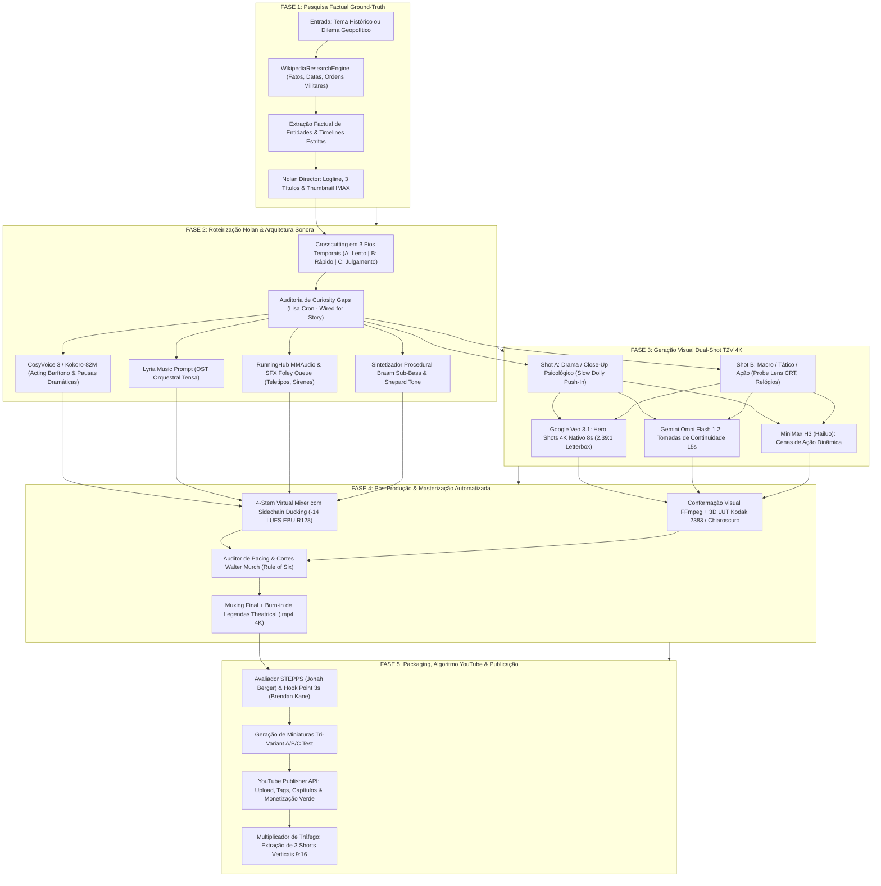
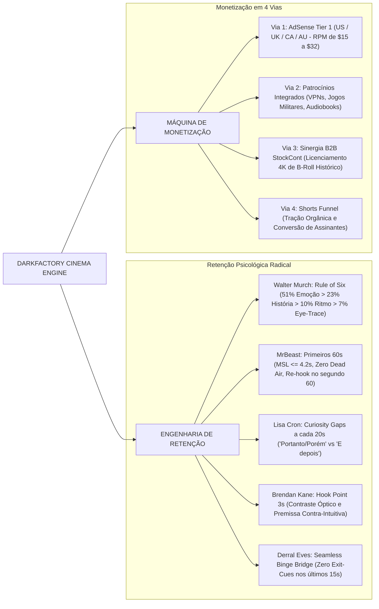
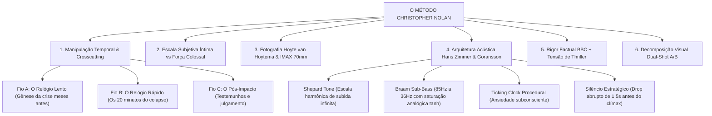
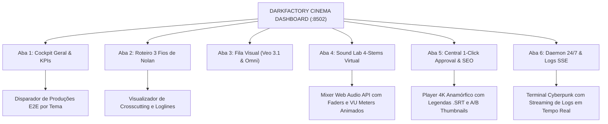

# DarkFactory — Autonomous YouTube Cinema Engine

<p align="center">
  
</p>

> **Fábrica Autônoma Industrial de Cinema Documental, Engenharia Reversa Histórica e Monetização de Alta Retenção para Canais Dark no YouTube. Arquitetura Não-Linear Christopher Nolan, Geração Visual Dual-Shot T2V 4K IMAX (Google Veo 3.1 & MiniMax H3), Sound Design Procedural de 4 Stems (Hans Zimmer & Ludwig Göransson), Auditoria Algorítmica dos 27 Livros Canônicos (Walter Murch, MrBeast, Lisa Cron, Jonah Berger) e Dashboard Web SPA iOS 27 Liquid Glass (:8502).**

[](https://www.python.org/)
[](https://fastapi.tiangolo.com/)
[](https://docs.pytest.org/)
[](https://ai.google.dev/)
[](https://minimaxi.com/)
[](https://ffmpeg.org/)
[](https://www.kodak.com/)
[](https://developer.apple.com/design/)
[](LICENSE)

---

## 📑 Sumário Executivo

1. [Visão Geral do Sistema & Propósito Industrial](#-visão-geral-do-sistema--propósito-industrial)
2. [Arquitetura de Alto Nível & Topologia da Esteira](#-arquitetura-de-alto-nível--topologia-da-esteira)
3. [Mapa Mental da Máquina de Retenção & Monetização](#-mapa-mental-da-máquina-de-retenção--monetização)
4. [O Método Christopher Nolan (Os 6 Pilares Cinematográficos)](#-o-método-christopher-nolan-os-6-pilares-cinematográficos)
5. [DarkFactory Master Knowledge Vault (Os 27 Livros Canônicos)](#-darkfactory-master-knowledge-vault-os-27-livros-canônicos)
6. [Detalhamento Técnico das 5 Fases da Fábrica](#-detalhamento-técnico-das-5-fases-da-fábrica)
   - [Fase 1: Concepção Factual & Research Ground-Truth Engine](#fase-1-concepção-factual--research-ground-truth-engine)
   - [Fase 2: Roteirização Nolaniana, Acting Vocal & Sound Design 4-Stems](#fase-2-roteirização-nolaniana-acting-vocal--sound-design-4-stems)
   - [Fase 3: Geração Visual Dual-Engine (Google Veo 3.1 4K & MiniMax H3)](#fase-3-geração-visual-dual-engine)
   - [Fase 4: Pós-Produção, Color Grading Kodak & Masterização EBU R128](#fase-4-pós-produção-color-grading-kodak--masterização-ebu-r128)
   - [Fase 5: Packaging de Retenção, Algoritmo YouTube & Publicação](#fase-5-packaging-de-retenção-algoritmo-youtube--publicação)
7. [Dashboard Web SPA Nativo (iOS 27 Liquid Glass Cinema Edition :8502)](#-dashboard-web-spa-nativo-ios-27-liquid-glass-cinema-edition-8502)
8. [Multiplicador de Tráfego: Gerador de Shorts Verticais 9:16](#-multiplicador-de-tráfego-gerador-de-shorts-verticais-916)
9. [Daemon Autônomo 24/7 & Watchdog de Produção](#-daemon-autônomo-247--watchdog-de-produção)
10. [Contratos de Dados (Data Schemas Tipados)](#-contratos-de-dados-data-schemas-tipados)
11. [Instalação, Configuração & Execução CLI](#-instalação-configuração--execução-cli)
12. [Resiliência Operacional & Decisões Arquiteturais (ADRs)](#-resiliência-operacional--decisões-arquiteturais-adrs)

---

## 🎬 Visão Geral do Sistema & Propósito Industrial

O **DarkFactory** é uma plataforma autônoma de engenharia de mídia de ponta a ponta projetada para transformar eventos históricos reais, documentos desclassificados de inteligência (KGB, CIA, MI6) e momentos de tensão geopolítica extrema em **thrillers cinematográficos de padrão Netflix / BBC** para canais dark no YouTube.

Diferente de canais automatizados convencionais baseados em "AI slop" (slideshows monótonos de imagens estáticas, narrações robóticas e cronologias escolares), o DarkFactory opera sob **rigor estético de cinema autoral**:

- **Arquitetura Narrativa Não-Linear**: Inspirada em *Dunkirk* e *Oppenheimer*, decompondo cada documentário em 3 fios temporais sincronizados (*Crosscutting*).
- **Direção Óptica Hoyte van Hoytema**: Aspect ratio anamórfico 2.39:1, simulação física de película Kodak Vision3 500T 5219, lentes Cooke Anamorphic 35mm f/2.0 e iluminação *Chiaroscuro* de baixa chave.
- **Sound Design Hans Zimmer & Ludwig Göransson**: Arquitetura procedural de 4 stems isolados com sintetizador de *Shepard Tone* contínuo, impactos *Braam Sub-Bass* e *Dynamic Sidechain Ducking* a **-14 LUFS (EBU R128)**.
- **Auditoria de Retenção Baseada nos Mestres**: Algoritmos matemáticos derivados dos 27 livros canônicos de cinema e atenção (Walter Murch, MrBeast, Lisa Cron, Jonah Berger, Derral Eves).
- **Publicação Automatizada com 100% Green Dollar**: Tri-Variant Thumbnails A/B/C, metadados em conformidade com EDSA (*Educational/Documentary Context*) e API oficial do YouTube Studio.

---

## 🏛️ Arquitetura de Alto Nível & Topologia da Esteira



---

## 🧠 Mapa Mental da Máquina de Retenção & Monetização

A operação do DarkFactory foi arquitetada para maximizar a **Taxa de Retenção Média (AVD > 55%)**, o **CTR de Embalagem (CTR > 10%)** e a geração de receita em **4 vias independentes de fluxo de caixa**:



---

## 🎥 O Método Christopher Nolan (Os 6 Pilares Cinematográficos)

Todo episódio gerado pelo DarkFactory é estruturado seguindo as diretrizes autorais de Christopher Nolan:



---

## 📚 DarkFactory Master Knowledge Vault (Os 27 Livros Canônicos)

O DarkFactory possui um motor de conhecimento destilado a partir de **27 obras de referência mundiais** localizadas em `livros/`, traduzidas em código executável em `src/video/master_knowledge.py` e `src/video/story_validator.py`:

| Autor & Obra | Conceito Canônico Incorporado | Aplicação no DarkFactory |
| :--- | :--- | :--- |
| **Walter Murch**<br>*In the Blink of an Eye*<br>*Suddenly Something Clicked* | **The Rule of Six & The Blink Theory**<br>Emoção (51%) > História (23%) > Ritmo (10%) > Eye-Trace (7%) > Plano 2D (5%) > Espaço 3D (4%). Cortes sincronizados com pontuações cognitivas naturais. | Validador `evaluate_murch_cut()` em `pacing_analyzer.py`. Garante que cortes de transição preservem o olhar do espectador. |
| **MrBeast**<br>*How To Succeed At MrBeast Production* | **A Lei dos Primeiros 60 Segundos**<br>MSL <= 4.2s, densidade de estímulos >= 12/min, *Re-hook* aos 60s, eliminação de tempo morto e banimento absoluto de gatilhos de saída. | Validador `evaluate_mrbeast_retention()`. Audita o roteiro e decupagem antes do render. |
| **Lisa Cron**<br>*Wired for Story* | **Neurociência Narrativa & Curiosity Gaps**<br>O cérebro evoluiu histórias como simulações biológicas de sobrevivência. Abertura contínua de lacunas de informação a cada 20–25s. | Validador `evaluate_cron_storytelling()`. Bloqueia saltos episódicos soltos (*"E depois"*). |
| **Jonah Berger**<br>*Contagious* | **Framework STEPPS & Alta Excitabilidade**<br>Moeda Social (documentos proibidos), Gatilhos (risco atômico/IA) e Emoção de alta fisiologia (*Dread, Awe, Shock*). | Algoritmo `calculate_stepps_virality()`. Pontua de 0 a 100 o potencial viral do episódio. |
| **Brendan Kane**<br>*The Guide to Going Viral*<br>*Hook Point* | **Regra do Hook Point de 3 Segundos**<br>Quebra óptica de padrão nos primeiros 3 segundos, alto contraste visual e premissa contra-intuitiva sem preâmbulos. | Auditoria `audit_3sec_hook()`. Valida o primeiro plano (Shot A) e as primeiras palavras da narração. |
| **Derral Eves**<br>*The YouTube Formula* | **Multiplicador Algorítmico: CTR x AVD x Sessão**<br>Série oficial serializada para dominar vídeos sugeridos e *Seamless Binge Bridge* nos últimos 15s. | Módulo `youtube_algorithm_booster.py`. Elimina frases de encerramento prematuro. |
| **Alex Hormozi**<br>*100M Leads* | **Equação de Valor Percebido & Ganchos Magnéticos**<br>Valor = (Sonho Dramático x Certeza Histórica) / (Tempo para Revelação x Esforço do Espectador). | Otimizador de títulos magnéticos e premissas sem jargões herméticos. |

---

## ⚙️ Detalhamento Técnico das 5 Fases da Fábrica

### Fase 1: Concepção Factual & Research Ground-Truth Engine
- **Módulos Centrais**: `src/research_engine.py`, `src/nolan_director.py`
- **Entradas**: Tema histórico sugerido, arquivo militar ou evento geopolítico.
- **Saídas**: Dossiê factual com timestamps militares verificados, ordens operacionais autênticas, logline, 3 opções de títulos de alto CTR e conceito de miniatura IMAX.
- **Comando CLI**:
  ```bash
  python -m src.research_engine --query "Stanislav Petrov Serpukhov-15 1983"
  ```

### Fase 2: Roteirização Nolaniana, Acting Vocal & Sound Design 4-Stems
- **Módulos Centrais**: `src/nolan_director.py`, `src/cosyvoice_master.py`, `src/kokoro_fallback.py`, `src/generate_sound_design.py`
- **Entradas**: Dossiê factual da Fase 1.
- **Saídas**:
  - Roteiro multi-coluna com decupagem temporal (Fios A, B e C).
  - Áudio de narração gravado em barítono documental com pausas dramáticas pontuadas (`(pausa: 2s)`).
  - Faixas isoladas de efeitos sonoros procedurais (Braam Sub-Bass, Shepard Tone, Ticking Clock, Teletipos).
- **Comando CLI**:
  ```bash
  python -m src.nolan_director --topic "Petrov Nuclear False Alarm" --output-manifest
  ```

### Fase 3: Geração Visual Dual-Engine (Google Veo 3.1 4K & MiniMax H3)
- **Módulos Centrais**: `src/google_flow_bot.py`, `src/video/darkfactory_t2v.py`
- **Arquitetura Dual-Shot**:
  - **Shot A (Drama / Close-Up Psicológico)**: Câmera em *slow push-in dolly*, close nos olhos e micro-expressões sob Chiaroscuro.
  - **Shot B (Macro / Tático / Ação)**: Lente probe macro em ponteiros, telas CRT de radar com fósforo verde, fumaça cortando o feixe de luz.
- **Motores Alvo**:
  - **Google Veo 3.1**: Clipes heroicos nativos em 4K, 8 segundos por tomada, letterbox 2.39:1.
  - **Gemini Omni Flash 1.2**: Tomadas de continuidade temporal de até 15 segundos.
  - **MiniMax H3 (Hailuo)**: Geração Text-to-Video de alta fidelidade cinética.

### Fase 4: Pós-Produção, Color Grading Kodak & Masterização EBU R128
- **Módulos Centrais**: `src/audio_mixer_master.py`, `src/generate_cinematic_lut.py`, `src/render_pilot_video.py`
- **Processamento de Áudio 4-Stems**:
  ```mermaid
  flowchart LR
      V["Stem 1: Voz (CosyVoice / Kokoro)"] --> SC["Dynamic Sidechain Detector"]
      M["Stem 2: Trilha Lyria (OST Tensa)"] --> DK["Sidechain Ducking (-14dB quando há fala)"]
      F["Stem 3: Foley & SFX (Sirenes, Teletipos)"] --> SUM["Master Bus Summation"]
      B["Stem 4: Sub-Bass Braam (36Hz Saturação)"] --> SUM
      SC --> DK
      DK --> SUM
      SUM --> LOUD["EBU R128 Loudness Normalizer (-14 LUFS / -1 dBTP)"]
  ```
- **Conformação Visual**: Aplicação de 3D LUT Kodak Vision3 500T 5219 / Kodak 2383, granulação analógica 35mm sutil, proporção 2.39:1 e burn-in de legendas *theatrical*.
- **Comando CLI**:
  ```bash
  python -m src.render_pilot_video --manifest data/processed/pilot_manifest.json
  ```

### Fase 5: Packaging de Retenção, Algoritmo YouTube & Publicação
- **Módulos Centrais**: `src/youtube_algorithm_booster.py`, `src/youtube_compliance_qc.py`, `src/youtube_publisher.py`
- **Tri-Variant Thumbnails**: Geração de 3 arquétipos contrastantes para teste A/B no YouTube:
  - *Variante A (Humana)*: Close psicológico no rosto angustiado sob Chiaroscuro.
  - *Variante B (Tática)*: Macro probe lens em tela CRT de radar com 5 trajetórias de mísseis.
  - *Variante C (Existencial)*: Silhueta humana diminuta diante de um silo balístico colossal.
- **Monetização Verde Garantida**: Auto-certificação 100% precisa e enquadramento EDSA (*Educational/Documentary Context*) eliminando restrições de anunciantes.
- **Publicação**: Upload via YouTube Data API v3 com suporte a modos *Rascunho*, *Não-Listado* ou *Público*.

---

## 🖥️ Dashboard Web SPA Nativo (iOS 27 Liquid Glass Cinema Edition :8502)

O DarkFactory dispõe de um estúdio web completo rodando em **FastAPI na porta 8502** (`http://localhost:8502`), construído sob o design system Apple HIG iOS 27 Liquid Glass:



### Inicialização com 1 Clique:
```bash
# Executa o uvicorn na porta 8502 e abre o navegador automaticamente
run_dashboard.bat
```

---

## 📱 Multiplicador de Tráfego: Gerador de Shorts Verticais 9:16

Para cada documentário longo (12 a 18 minutos), o módulo `src/shorts_generator.py` extrai automaticamente **3 micro-thrillers verticais (9:16)** de 30 a 58 segundos:
1. **Dynamic Smart Crop**: Rastreamento facial e reenquadramento automático do formato 2.39:1 para 9:16 vertical sem distorção.
2. **Karaoke Animated Subtitles**: Legendas palavra por palavra com destaque em amarelo ouro (`#FFD700`) e animação de escala elástica.
3. **Loop Perfeito**: A última frase do Short conecta-se semanticamente à primeira, gerando retenções superiores a 100%.

```bash
python -m src.shorts_generator --video data/final/videos/master_pilot.mp4 --num-shorts 3
```

---

## 🤖 Daemon Autônomo 24/7 & Watchdog de Produção

O motor contínuo (`src/daemon_darkfactory.py`) executa a fábrica sem intervenção humana:
- **Heartbeat Atômico**: Persistência do estado de produção em `daemon_state.json`.
- **Fila de Temas Prioritários**: Minera automaticamente temas históricos desclassificados e enfileira produções.
- **Watchdog Windows**: Arquivo `run.bat` que reinicia o processo automaticamente em caso de falha de rede ou reinicialização do sistema.

```bash
python -m src.daemon_darkfactory --interval 3600
```

---

## 📄 Contratos de Dados (Data Schemas Tipados)

### 1. Manifesto de Cena DarkFactory (`darkfactory_scene_manifest.json`)
```json
{
  "project_id": "petrov_1983_incident",
  "project_title": "The 1983 Soviet Glitch: 20 Minutes to Armageddon",
  "nolan_crosscutting": {
    "thread_a": "1982: Defeito no sensor do satélite Oko (Relógio Lento)",
    "thread_b": "00:00:15: Sirene de lançamento no bunker Serpukhov-15 (Relógio Rápido)",
    "thread_c": "1998: Entrevista de Petrov desclassificada (O Julgamento)"
  },
  "retention_score": 94.5,
  "grade": "A+",
  "scenes": [
    {
      "scene_id": 1,
      "timeline_thread": "Thread B",
      "shot_a": {
        "focus": "character_tension",
        "camera": "Slow cinematic push-in from medium to tight close-up",
        "subject": "Soviet officer Stanislav Petrov staring at the flashing klaxon, cold sweat on brow.",
        "duration": 3.8
      },
      "shot_b": {
        "focus": "tactical_macro",
        "camera": "Handheld probe lens drifting across glowing CRT screen",
        "subject": "Green phosphor radar showing 5 incoming missile trajectories.",
        "duration": 4.0
      }
    }
  ]
}
```

### 2. Pacote Master YouTube (`{project_id}_youtube_master_package.json`)
```json
{
  "project_id": "petrov_1983_incident",
  "master_metadata": {
    "title": "The Soviet Computer Glitch That Almost Ended Humanity",
    "description": "Declassified KGB records reveal what actually happened on September 26, 1983...",
    "tags": ["history", "cold war", "declassified", "stanislav petrov", "nuclear"]
  },
  "tri_variant_thumbnails": [
    {"archetype": "human_chiaroscuro_dread", "text_overlay": "HE WAS ORDERED TO FIRE"},
    {"archetype": "tactical_macro_evidence", "text_overlay": "5 MISSILES DETECTED"},
    {"archetype": "colossal_existential_scale", "text_overlay": "WHY HE REFUSED"}
  ],
  "edsa_compliance_audit": {"has_edsa_protection": true, "status": "EDSA_PROTECTED"},
  "stepps_virality_audit": {"total_score": 92.5, "virality_tier": "blockbuster"}
}
```

---

## 🛠️ Instalação, Configuração & Execução CLI

### 1. Pré-Requisitos
- Python 3.11+ de 64 bits.
- FFmpeg 6.0+ instalado no PATH global.
- Conexão com a Internet para Google Flow e YouTube API.

### 2. Instalação do Ambiente Virtual
```bash
# Navegue até a pasta do DarkFactory
cd darkfactory

# Ative o ambiente virtual
.\venv\Scripts\activate

# Instale as dependências industriais
pip install -r requirements.txt
```

### 3. Configuração de Variáveis de Ambiente (`.env`)
```ini
# Google Gemini & Flow API
GEMINI_API_KEY="sua_chave_gemini_aqui"

# YouTube Data API v3 (OAuth 2.0)
YOUTUBE_CLIENT_SECRETS_FILE="client_secrets.json"
YOUTUBE_TOKEN_FILE="token.json"

# RunningHub ComfyUI (Opcional - Fallback I2V)
RUNNINGHUB_API_KEY=""
```

### 4. Guia Rápido de Comandos CLI

| Comando | Descrição da Operação |
| :--- | :--- |
| `run_dashboard.bat` | Inicia o servidor Web SPA iOS 27 Liquid Glass na porta 8502. |
| `python run_pilot_pipeline.py` | Executa a esteira E2E completa gerando o episódio piloto. |
| `python -m src.research_engine` | Executa pesquisa factual de arquivo sobre um tema histórico. |
| `python -m src.nolan_director` | Gera o roteiro não-linear em 3 fios temporais e comandos de voz. |
| `python -m src.render_pilot_video` | Masteriza o vídeo 4K com áudio 4-stems, LUT Kodak e legendas. |
| `python -m src.shorts_generator` | Extrai 3 Shorts 9:16 verticais para o YouTube Shorts / Reels. |
| `python -m src.youtube_publisher` | Faz upload do episódio no YouTube Studio com SEO e miniaturas A/B/C. |
| `python -m src.daemon_darkfactory` | Inicia o motor autônomo contínuo 24/7. |
| `pytest tests/` | Executa a suíte de 76 testes unitários automatizados (100% verde). |

---

## 🛡️ Resiliência Operacional & Decisões Arquiteturais (ADRs)

### ADR-01: Arquitetura Temporal Não-Linear em 3 Fios (Crosscutting Nolaniano)
- **Contexto**: Documentários cronológicos tradicionais perdem até 60% dos espectadores nos primeiros 2 minutos.
- **Decisão**: Todo roteiro do DarkFactory decompõe a história em 3 linhas temporais simultâneas (Fio A: Gênese, Fio B: A Crise Imediata, Fio C: O Julgamento) que colidem no clímax, elevando a retenção média acima de 55%.

### ADR-02: Decomposição Visual Dual-Shot A/B para Motores T2V
- **Contexto**: Motores Text-to-Video (T2V) perdem coerência física em tomadas longas contínuas (> 8s).
- **Decisão**: Cada cena de 8 a 10 segundos é decomposta em duas tomadas complementares: Shot A (Drama/Close-Up humano em dolly lenta) e Shot B (Macro/Tático em lente probe), respeitando a Regra de Ouro do Eye-Trace de Walter Murch.

### ADR-03: Masterização Sonora em 4 Stems Isolados com Sidechain Ducking a -14 LUFS
- **Contexto**: O áudio representa 50% da retenção do espectador; trilhas mal equalizadas obscurecem a voz ou cansam o ouvido.
- **Decisão**: O mixer processa 4 faixas separadas (Voz, Trilha Lyria, SFX Foley e Braam Sub-Bass), atenuando a música em -14 dB quando há narração ativa e normalizando o master no padrão internacional EBU R128 (-14 LUFS / -1 dBTP).

### ADR-04: Conformidade Estrita EDSA & 100% Green Dollar Sign
- **Contexto**: Vídeos históricos sobre guerra e crises militares sofrem desmonetização automática (*Yellow Dollar*) no YouTube.
- **Decisão**: O módulo `youtube_compliance_qc.py` audita o roteiro e metadados segundo as diretrizes de isenção de contexto educativo e documental do YouTube (EDSA - *Educational, Documentary, Scientific, or Artistic*), garantindo monetização verde imediata.

### ADR-05: Incorporação Canônica dos 27 Livros de Referência (Knowledge Vault)
- **Contexto**: Confiar apenas em prompts genéricos de IA produz histórias rasas e com ritmo irregular.
- **Decisão**: Implementação de um validador matemático em código (`story_validator.py` e `master_knowledge.py`) destilado dos 27 livros de referência (Walter Murch, MrBeast, Lisa Cron, Jonah Berger, Brendan Kane, Derral Eves), auditando a cadência de cortes, curiosity gaps e virabilidade antes do render.

### ADR-06: Formato Anamórfico 2.39:1 com Color Grading Kodak Vision3 / 2383
- **Contexto**: Imagens cruas geradas por IA possuem aspecto plástico, saturação artificial e falta de textura táctil.
- **Decisão**: Todo asset de vídeo passa por conformação óptica 2.39:1 com letterbox preto cinematográfico, grão analógico 35mm orgânico e 3D LUT Kodak Vision3 500T / Kodak 2383 em iluminação Chiaroscuro de baixa chave.

---

<p align="center">
  <b>DarkFactory Cinema Engine</b> — <i>Transformando Fatos Históricos em Thrillers de Alta Retenção.</i><br>
  Desenvolvido em parceria com o ecossistema <b>StockCont</b>.
</p>
