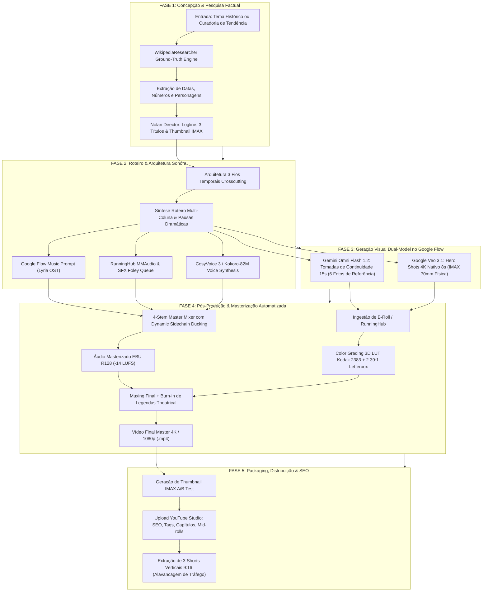
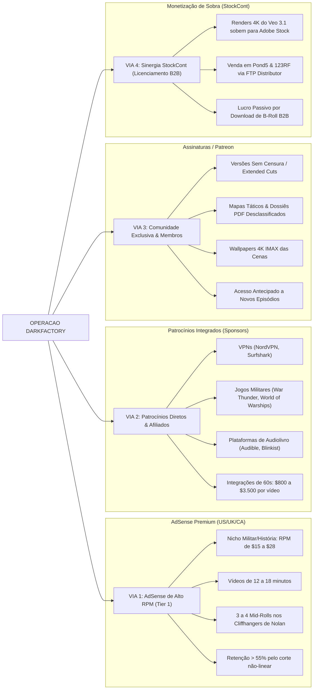

# 🗺️ Roadmap de Monetização E2E & Mapa Mental da Operação — DarkFactory

> **Documento Estratégico & Operacional (SSOT)**  
> **Nicho**: Documentários Históricos Cinemáticos & Geopolítica Secreta (Público-Alvo: US / UK / CA / AU)  
> **Estilo Autoral**: Christopher Nolan (Retenção Extrema, 4K IMAX 70mm, 4-Stem Sound Design Zimmer/Göransson)  
> **Esteira de Produção**: DarkFactory + Google Flow (Omni Flash 1.2 + Veo 3.1 4K) + RunningHub

---

## 🧭 1. Fluxograma Operacional E2E (Da Mineração ao Upload)

Este fluxograma mapeia cada etapa técnica da fábrica, desde a pesquisa factual até a publicação no YouTube com SEO de retenção.

---

## 🧠 2. Mapa Mental da Máquina de Monetização & Escala

A operação de monetização não depende apenas do AdSense comum. Ela é desenhada como uma **máquina de fluxo de caixa em 4 vias independentes**.

---

## 📅 3. Cronograma Tático de 90 Dias (Do Zero ao Primeiro Dólar)

### Mês 1: Fundação, Identidade e os Primeiros 4 Pilares (Dias 1 a 30)
- **Semana 1: Configuração do Canal & Branding de Elite**:
  - Criar conta Google/YouTube dedicada com dados e idioma definidos para o mercado norte-americano/global (Inglês).
  - Identidade visual sóbria e minimalista estilo HBO/Netflix (Nome exemplo: *The Redacted Dossier*, *Protocol Zero*, *Chronos War Archives*).
  - Design do Banner e Avatar com texturas granulares 70mm e tipografia limpa.
- **Semanas 2 a 4: Produção e Publicação dos 4 Vídeos Piloto**:
  - Produzir 4 episódios impecáveis de 10 a 14 minutos utilizando a esteira DarkFactory completa:
    1. *The 1983 Soviet Glitch (Stanislav Petrov)*.
    2. *The Lost Cosmonaut of Soyuz 1 (Vladimir Komarov)*.
    3. *The Broken Arrow of Goldsboro (1961 Near-Detonation)*.
    4. *The Siberian Hell Hole & The Secret Kola Drill*.
  - Para cada vídeo longo, recortar **2 a 3 Shorts (60s)** a partir do Cold Open de alta tensão com legenda dinâmica para alavancar a descoberta orgânica de novos espectadores.

---

### Mês 2: Acelerando o Algoritmo & Cumprindo Metas do YPP (Dias 31 a 60)
- **Meta Crítica**: Bater **1.000 inscritos** e **4.000 horas de exibição pública** (Watch Time).
- **Por que a esteira DarkFactory atinge 4.000 horas rapidamente?**:
  - Vídeos de 12 minutos com taxa de retenção média de 55% acumulam aproximadamente **6,5 minutos de watch time por visualização**.
  - São necessárias apenas **37.000 visualizações somadas** em todos os vídeos longos para bater as 4.000 horas (canais de entretenimento genérico precisam de 100k+ views porque a retenção cai aos 2 minutos).
- **Estratégia Anti-Rejeição do YouTube Partner Program (YPP)**:
  - Canais dark comuns são rejeitados por "Conteúdo Repetitivo" ou "Automação de Baixo Esforço".
  - O DarkFactory é imune a isso porque:
    - O roteiro é baseado em pesquisa factual primária com citações autênticas (BBC style).
    - O acting vocal não é voz robótica monotônica; utiliza modulação dramática (CosyVoice/Gemini Audio).
    - O visual utiliza tomadas com 3D LUT autoral Kodak 2383, letterbox anamórfico e edição multi-camada.
    - O áudio é mixado em 4 stems independentes com Dynamic Sidechain Ducking.

---

### Mês 3: Ativação Total do YPP & Primeiros Patrocínios (Dias 61 a 90)
- **Dia 65**: Envio da solicitação para o YPP (YouTube Partner Program). Aprovação ocorre tipicamente em 48 a 72 horas.
- **Configuração de Mid-Rolls Estratégicos**:
  - Posicionar anúncios exatamente nos momentos de *cliffhanger* de Nolan (logo após a queda de silêncio dramática ou antes de revelar o desfecho do enigma temporal). Isso evita que o espectador saia do vídeo durante o anúncio.
- **Primeiro Pacote de Patrocínio (Sponsor Integration)**:
  - Com média de 25k a 50k views por episódio, cadastrar o canal em redes como *ThoughtLeaders*, *ChannelPages* ou prospecção direta via email comercial configurado no banner (contato comercial dedicado).

---

## 💰 4. Economia da Unidade (Unit Economics) & Projeção Financeira

### Comparativo de RPM por Geografia & Nicho

| Nicho | País Principal | RPM Médio (por 1.000 views) | Retenção Típica | Potencial por 100k views |
| :--- | :--- | :--- | :--- | :--- |
| Curiosidades Genéricas (PT-BR) | Brasil | \$1.20 - \$2.50 | 35% | \$120 - \$250 |
| Cenas de Filmes / Cortes (Shorts) | Global | \$0.05 - \$0.15 | 80% (Shorts) | \$10 - \$15 |
| **DarkFactory: História & Defesa (EN)** | **EUA / UK / CA** | **\$14.00 - \$24.00** | **55% - 65%** | **\$1.400 - \$2.400** |

> [!TIP]
> Um único vídeo com 150.000 visualizações no público americano do nicho histórico militar rende entre **\$2.100 e \$3.600 dólares** apenas de AdSense, sem contar patrocínios de marcas de VPN e games que adicionam mais **\$1.000 a \$2.000 por vídeo**.

### Projeção Semestral de Faturamento (Cenário Conservador)

- **Mês 1**: \$0 (Fase de construção e plantio).
- **Mês 2**: \$0 - \$200 (Início da monetização no fim do mês).
- **Mês 3**: \$1.200 - \$2.500 (YPP ativo em 8 vídeos de catálogo + primeiros mid-rolls).
- **Mês 4**: \$3.000 - \$5.500 (Catálogo trabalhando 24/7 + 1 patrocinador integrado).
- **Mês 5**: \$5.500 - \$9.000 (Efeito bola de neve do algoritmo + Clube de Membros).
- **Mês 6**: \$8.000 - \$14.000+ (Média de 8 vídeos/mês + 2 patrocinadores + microstock passivo).

---

## ⚡ 5. Checklist de Publicação Perfeita (O "Nolan Upload Protocol")

Antes de clicar em "Publicar", o operador cumpre este checklist rigoroso:

- [ ] **Título**: Fórmula do Paradoxo ou Corrida contra o Tempo (Ex: *The 1983 Soviet Glitch: 20 Minutes to Armageddon*).
- [ ] **Thumbnail**: Contraste chiaroscuro violento, foco em 1 elemento humano versus 1 máquina/ameaça colossal, máximo 3 a 4 palavras em caixa alta no texto de apoio.
- [ ] **Primeiros 15 Segundos (Cold Open)**: Sem vinheta, sem "inscreva-se no canal", sem enrolação. Começa com a sirene tocando e o narrador entregando a frase do paradoxo existencial.
- [ ] **Capítulos (Timestamps)**: Inseridos na descrição para melhorar o SEO de busca orgânica do YouTube e do Google.
- [ ] **Cards & Tela Final**: Apontando para o próximo episódio temático relacionado, criando uma esteira de *binge-watching* (sessão contínua de consumo).
- [ ] **Legendas (SRT)**: Injetadas em inglês limpo, aumentando a acessibilidade e a preferência do algoritmo de busca.
- [ ] **Sincronização StockCont**: Os clipes em 4K do Veo 3.1 gerados para o vídeo são movidos para o catalogador do StockCont para venda em agências de microstock.
